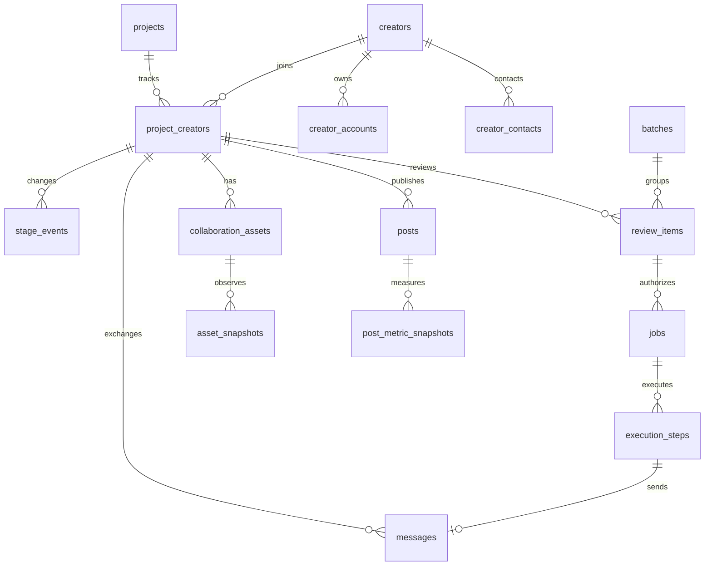

# kolpick 数据库设计说明书

| 文档属性 | 内容 |
| --- | --- |
| 编号／版本 | KOLPICK-DBDS-001 / 1.10，定稿 |
| 日期 | 2026-10-27定稿，Asia/Shanghai |
| 状态 | 已定稿，作为实施依据；尚未建表、迁移或改代码 |
| 范围 | 一位运营，找人、联系、判断、执行、跟进和看发布效果 |
| 数据库 | PostgreSQL，目标业务schema为`kol_app`；现有`kol`原样搬库结构在切换后只读存档 |
| 已确认前提 | 一次切换到全部22张表，不分批、不留新旧混用期；当前所有项目统一一台执行电脑、保留本机锁；测试使用独立数据库，可与正式库处于同一实例 |
| 文档分工 | [design.md](design.md)维护产品规则和现状；本文维护数据模型和切换规则；[data-api.md](data-api.md)维护外部合同 |

表与字段从运营动作反推，旧飞书字段只作为迁移输入。22张表一次建成、一次切换：第5节是主数据与跟进，第6节是规则、沟通、审核执行与效果，第10节是切换和迁移。待确认的业务变化单独列在第11节，未确认的按现行行为实现。

## 目录

1. [运营需求与字段取舍](#s1)
2. [部署前提与一次切换](#s2)
3. [表清单与业务关系](#s3)
4. [公共约定](#s4)
5. [主数据与跟进的数据字典](#s5)
6. [规则、沟通、审核执行与效果的数据字典](#s6)
7. [项目扩展与参数合同](#s7)
8. [状态权威与事务用法](#s8)
9. [约束、索引和查询](#s9)
10. [迁移与切换](#s10)
11. [待确认项与验收](#s11)
12. [依据与版本记录](#s12)

<a id="s1"></a>
## 1. 运营需求与字段取舍

### 1.1 每天需要回答的问题

| 运营问题 | 实际动作 | 必需信息 | 依据 |
| --- | --- | --- | --- |
| 今天先处理谁？ | 查看待办、逾期和待回复列表 | 项目KOL、阶段、沟通责任、来信、下次跟进、当前待审 | console/state.ts、today.ts |
| 这个人适不适合邀约？ | 挑候选、补资料 | 各平台账号、粉丝、内容类型、市场、语言、邮箱、入库来源 | find.ts、classify.ts、候选池页面 |
| 用什么方式联系、怎么称呼？ | 选邮箱、选模板、生成具体邮件 | 联系方式、发信渠道、称呼、语言、已批准模板 | invite.ts、templates.ts |
| 对方刚说了什么，我应该回什么？ | 读来往、改草稿、批准／修改／跳过 | 消息原文、明确收件人、草稿、附带动作、批准证据 | inbox.ts、reviews.ts |
| 信发出去了吗？码建好了吗？ | 看结果、核对失败和不明结果 | 每个外部步骤的结果、外部ID、最终邮件、待补记事项 | send.ts、trial.ts、partner.ts |
| 要不要催、延期或结束跟进？ | 提醒、延期、关闭／重开 | 静默时长、已成功催信次数、体验用量及观测时间、关闭原因 | remind.ts、trialfollow.ts |
| 对方有没有发、效果怎样？ | 查看承诺日期、记链接、看观测 | 约定日期、帖子、平台、真实采集时间、播放互动、码用量 | posts.ts、metrics.ts、codes.ts |
| 今天的规则或模板怎么改？ | 调额度、停发、改模板、停用邮箱 | 设置、渠道配置、模板版本、修改记录 | design.md设置页要求 |

没有对应操作、筛选、自动规则、分析问题或恢复需要的字段，不进入业务模型。技术字段还须说明其承担的具体约束；不能只因通用系统通常有这一列而加入。

### 1.2 字段分类与处置

| 类别 | 具体字段／结构 | 处置与理由 |
| --- | --- | --- |
| 日常必需 | 账号、主页、各账号粉丝数、邮箱、称呼、市场、语言、内容类型、合作方向 | 保留，解决找人、挑人和写信 |
| 日常必需 | 阶段、优先级、对方要求、下一步、跟进日期、约定发布日期 | 保留，即使部分字段填得少，也直接驱动提醒和业务决定 |
| 条件必需 | 体验码、活动码、用量、到期、链接、折扣 | 保留，进collaboration_assets，项目专有部分由项目模块校验 |
| 可计算 | 粉丝分层；跟进里的主页、粉丝数、平台、公开邮箱副本 | 通过关联／计算得到，不独立维护 |
| 可计算 | “等你审核”、最新帖子、最新播放数、催信次数 | 从未终结审核项、帖子、观测、成功发送记录生成 |
| 机器必需、运营不填 | 消息去重键、批准哈希、外部followupId、步骤结果、来信版本号 | 保留，不因界面看不到而删除 |
| 历史兼容 | 备选批次、确认发出旧勾选、提交检查公式、旧双向关联数组、“只认决策台的同意” | 只留在脱敏源快照；目标模型不增加字段 |
| 有使用记录 | 标签、合作要求、交付清单 | 保留：标签和交付清单为数组，合作要求为文本 |
| 非本系统职责 | 月度结算、付款、分润、营收和订单经营表 | 不建新活跃表，只留源快照；金额业务仍在TAFU |
| 过早的工程结构 | 执行器代数、数据库租约、独立逐次调用表、通用actor表、多态迁移映射表 | 不建；以后有恢复或多人运行需求再评估 |

“未在当前页面读取”不等于“运营不用”。2026-10-26测试副本的非空统计：标签12,634条、合作要求104条、交付清单19条、约定发布日期9条；这些数字说明有历史使用，不证明使用频率。粉丝分层有13,937条，但可由粉丝数计算，仍属于可消除的重复事实。

### 1.3 维持现有业务边界

- 找到的人直接入库；Claude继续通过限定字段接口补方向、市场、语言、内容类型和称呼，不增加逐条人工采纳步骤。写入来源和修改差异留审计；不能借补资料接口批准、发信、解除禁联。
- 同一人可有多个平台账号；同一个邮箱可服务多位博主。同名账号或共同邮箱不能直接当作同一身份。
- 禁止联系是项目级规则；跨项目冷却仍按邮箱核对。
- 回复审核、未知结果人工确认、已成功步骤不得重复执行等现有保护继续保留。
- 金额、结算、付款、退款归TAFU；kolpick只使用确实提供的码和效果数据。
- 自动催信／结案、模板改版等行为尚有产品文档与实现差异，见第11节；未确认前切换后照现行行为实现，数据库重构本身不改变这些行为。

<a id="s2"></a>
## 2. 部署前提与一次切换

### 2.1 测试与正式：独立数据库，已确认

目标为`kolpick_prod`与`kolpick_test`两个数据库，名称为示例；可以在同一PostgreSQL实例内，不要求先新增服务。每个数据库内部可以放多个真实业务项目。`project_id`区分业务项目，不兼任环境隔离。

现在`tafu-test`和其他数据放在`kol-find`服务的同一个库里，所以分库是切换前必须完成的调整。测试库用正式数据的脱敏副本，不复制可用的真实发信／写码凭据；测试渠道默认停用。

### 2.2 执行器：统一一台电脑，已确认

- 所有项目使用同一台执行电脑和现有本机串行锁：20秒心跳、90秒无心跳锁失效、执行中超过15分钟按中断结果不明处理。
- 执行电脑编号存在每个项目的`project_settings.executor_machine_id`，`kol executor claim`一次写全部项目；执行器启动时检查一致。
- 不增加`executor_state`、数据库租约、代数和跨机器接管。90秒锁失效只影响本机调度，不构成“之前外部动作一定没执行”的证据。
- “多个项目分别由不同机器执行”及“服务端多实例接管”是另一个设计问题，不在本次切换中实现。

### 2.3 一次切换，不留混用期

所有项目、所有业务数据在同一次切换中从旧存储进入`kol_app`，插件和决策台同时换成只读写`kol_app`的版本：

```text
正式 tafu：飞书多维表格 ─► 导入器（脱敏、映射、核对）─► kolpick_prod.kol_app 全部22张表
                                     └─ 同一份脱敏结果 ─► kolpick_test.kol_app（演练和日常测试）
```

- **只有一个数据来源。** 正式数据都在飞书表；测试库用同一次导出的脱敏结果生成。现有`tafu-test`在`kol.*`里的数据是旧副本，不再导入，切换后只读保留。
- **不保留按项目选择存储。** 切换版本删除飞书Base读写和`kol.*`原样搬库的业务读写路径（`StoreLark`、`PgStore`、本机副本rowcache）；飞书邮箱、通讯录、群通知继续使用。
- **不做新旧字段混用。** 不存在一条跟进一半在新表、一半在旧行的状态，也不需要把新结构投影回中文字段Row的适配器。
- **导入器复用现有飞书读取代码。** 取出的记录和现在命令看到的一样，映射规则只写一套（第10节）；可以对同一份导出反复重跑。
- **代码一次改完。** invite／send／sync／classify／remind等命令和决策台都直接用`kol_app`，Claude读写单条记录也走插件命令，不再直接调用飞书Base。这是一次较大的代码改动，不能声称建表后业务代码不动。
- **设置页直接做在新表上。** project_settings、channels、templates就是设置页的数据，不先在旧设置表上做一遍。

### 2.4 切换后旧数据怎么处理

- 飞书多维表格：切换后设为只读，作为原始存档；飞书Base适配代码在切换版本中删除。
- `kol.*`：切换后只读，保留到核对报告确认后再决定是否删除。
- 切换后如果已经发生新的发送或建码，不能恢复旧快照重跑；回退规则见§10.4。

<a id="s3"></a>
## 3. 表清单与业务关系

### 3.1 22张表

| 业务域 | 表 | 回答的问题 |
| --- | --- | --- |
| 主数据与跟进 | projects、creators、creator_accounts、creator_contacts、project_creators、stage_events | 这是谁、有哪些账号和邮箱、在本项目走到哪、阶段怎么变的 |
| 规则与邮箱 | project_settings、channels、mail_sync_state | 发信额度和规则是什么、用哪个邮箱、收信收到哪了 |
| 找人与邀约 | batches | 这批人按什么条件找来、这次邀约发给了谁 |
| 沟通、模板、审核、执行 | messages、templates、template_versions、review_items、jobs、execution_steps、audit_events | 对方说了什么、要我决定什么、批准了什么、外部动作做成没有、谁改了什么 |
| 合作与效果 | collaboration_assets、asset_snapshots、posts、post_metric_snapshots | 码和活动现在怎样、每天用量如何、发了什么帖子、效果多少 |
| 运行 | runs | 每次命令或例行做了什么 |

### 3.2 从1.0撤去的复杂度

不单建actor表、邮箱地址主表、标签及贴标关系表、发现明细表、审核版本与决定两张表、投递正文副本表、调用尝试表、执行器租约表、两张通用迁移表。身份用可信操作者引用；共享邮箱允许关系行复用地址；审核批准后的行冻结、改稿另建关联行；外发内容只在messages持久化；步骤保留结果，调用错误历史进审计；迁移使用脱敏快照和映射文件。

取消全表row_version和循环延迟外键。只有并发编辑确实影响正确性的草稿、模板指针使用version；主状态靠短事务锁。以后出现不能由这些机制满足的需求，再增加结构。

### 3.3 主业务关系



### 3.4 典型读写流程

| 场景 | 谁写、写什么 | 运营怎样使用 |
| --- | --- | --- |
| 每日查体验码用量 | 同步动作成功后，同事务更新collaboration_assets当前响应和成功时间，追加asset_snapshots；失败保留旧值并标记同步失败 | 跟进页看当前用量、到期和数据时间；趋势按成功观测计算，不把缺失日显示成零 |
| 记下发布并查看效果 | 手工确认或找帖动作写posts；指标采集将实际时刻及可得计数写post_metric_snapshots | 查看已确认发布、到期未发布、各次采集变化；自动发现未确认内容单独标识 |
| 修改发信规则并收信 | 运营修改project_settings／channels并写audit_events；同步器提交消息后推进mail_sync_state | 从设置页暂停、改额度、停用渠道；失败后继续补收，无需从运行标题推算进度 |
| 批准一封附带建码的回复 | 草稿和批准写review_items；事务创建job，按顺序执行建码、发信、补记步骤；最终主题正文写messages，决定与恢复证据写audit_events | 同一卡片看批准内容与job执行结果；失败时明确是码、信还是补记出问题，按第8节恢复 |
| 修改模板 | 编辑草稿版本，批准后按§8.4更新templates指针 | 查在用版本和未发布修改；历史发送始终能找到当时批准的内容 |
| 复盘一次邀约或命令 | 批次记录冻结参数和审核成员；runs汇总一次实际运行，具体事实仍引用消息与步骤 | 查这批为什么选这些人、发了多少、哪些失败；不使用汇总计数替代逐条结果 |

<a id="s4"></a>
## 4. 公共约定

### 4.1 一次说明的证据与安全规则

未知值保留NULL，零表示已知的零；观察时间与实际发生时间分开，历史缺失不使用导入时间替代。没有接口能力、外部ID或可信批准证据时只显示真实可得信息。密钥、含token的Webhook和认证头在**进入导出／存档／日志之前**删除或转为安全配置引用；原始档案不是保留密钥的例外。各字段说明不再重复这些规则。

### 4.2 类型、主键与标识

- 表名、列名使用英文snake_case。text枚举由代码和CHECK控制，中文为展示映射。
- 当前可访问实例为PostgreSQL 18.6，已验证存在`uuidv7()`。本稿新UUID主键建议`DEFAULT uuidv7()`；正式目标库上线前检查版本。时间顺序仍使用明确的时间字段。[PostgreSQL 18 UUID函数](https://www.postgresql.org/docs/18/functions-uuid.html)
- 时刻用timestamptz，业务日期用date；项目时区独立保存。旧数据只有日期时使用`*_date`及精度字段，或保留在源档待核对。
- 次数、粉丝数、观测计数使用非负bigint；比例以百分数保存，例如15表示15%；预算为numeric(12,4) USD。
- 邮箱匹配沿用现有大小写不敏感规则，不擅自删除点号或`+tag`。平台账号优先按平台稳定ID定位，没有ID时用平台内规范化URL。
- 外部followupId独立存储且稳定，不随内部UUID变化；现有TAFU接口依赖它识别资源。

### 4.3 公共字段组

N=不可空，Y=可空。“无”表示调用方显式提供。下文声明的公共组也是该表的实际字段。

| 组 | 字段 | 类型／空／默认 | 含义 |
| --- | --- | --- | --- |
| B | id | uuid／N／uuidv7() | 内部主键 |
| B | created_at | timestamptz／N／now() | 目标记录入库时间 |
| M | B全部字段、updated_at | timestamptz／N／now() | M继承B；updated_at由更新事务刷新 |
| P | project_id | uuid FK→projects／N／无 | 所属项目；项目内关联使用包含project_id的复合FK |

没有M组的记录原则上追加；需要补响应的执行步骤按规定更新结果。表未写version就不增加。操作者统一用`actor_ref text`：现在决策台只在执行电脑本机打开，真人写`human:local:<电脑编号>`；以后接飞书登录后写`human:feishu:<用户ID>`；另有`assistant:claude`和`system:<作业>`。值来自受信任运行上下文，姓名仅展示。现有本机共享凭据环境仍不构成强权限隔离。
<a id="s5"></a>
## 5. 主数据与跟进的数据字典

### 5.1 `projects` 项目

字段组：M。只放项目身份；运营规则在project_settings，密钥只在本机配置。

| 字段 | 类型 | 空／默认 | 说明与用法 |
| --- | --- | --- | --- |
| `slug` | text | N／无 | 稳定项目名，项目选择和唯一识别使用 |
| `name` | text | N／无 | 界面显示名 |
| `timezone` | text | N／Asia/Shanghai | 业务日和日期显示时区；迁移保留原偏移语义 |
| `adapter_key` | text | N／tafu | 当前实际项目模块；决定adapter_profile和adapter_settings的校验合同 |
| `archived` | boolean | N／false | 归档后停止创建新的运营动作 |

唯一键：slug。测试和正式分别在两个数据库，各自可有同名项目。

### 5.2 `creators` KOL主体

字段组：M。回答“这些账号属于谁”；不放项目阶段和禁联状态。

| 字段 | 类型 | 空／默认 | 说明与用法 |
| --- | --- | --- | --- |
| `display_name` | text | N／无 | 主体显示名称；可以是博主、团体或品牌名 |

不按姓名或邮箱做主体唯一约束。核实同一主体后可关联多账号；不建设自动合并功能。

### 5.3 `creator_accounts` 平台账号

字段组：M。粉丝、主页和简介均属于账号。

| 字段 | 类型 | 空／默认 | 说明与用法 |
| --- | --- | --- | --- |
| `creator_id` | uuid FK→creators | N／无 | 所属主体 |
| `platform` | text | N／无 | instagram、youtube、tiktok、facebook、threads、podcast、other；记录类型与实际抓取能力分开 |
| `external_account_id` | text | Y／NULL | 平台稳定账号ID，取得后优先用于识别 |
| `handle` | text | Y／NULL | 当前账号名，供展示和平台内搜索 |
| `display_name` | text | Y／NULL | 平台显示名 |
| `profile_url` | text | N／无 | 可访问主页；旧数据只有账号名时按平台规则拼出（见§10.2），拼不出的不建账号、进问题单 |
| `canonical_url` | text | N／无 | 按平台规则规范化后的地址，用于无外部ID时去重 |
| `bio` | text | Y／NULL | 简介，供Claude分类，不与运营备注混存 |
| `follower_count` | bigint | Y／NULL | 最新一次已知粉丝数 |
| `followers_observed_at` | timestamptz | Y／NULL | 上述粉丝数的采集时间 |
| `source` | text | N／无 | apify、manual、legacy |

唯一键：platform+external_account_id（ID非空）；platform+canonical_url。ID与URL映射冲突时进入核对。粉丝分层由数值计算，跨平台粉丝不默认相加。

### 5.4 `creator_contacts` 主体联系方式

字段组：M。一行是一位KOL与一个邮箱的关系，允许多个KOL使用同一个地址。

| 字段 | 类型 | 空／默认 | 说明与用法 |
| --- | --- | --- | --- |
| `creator_id` | uuid FK→creators | N／无 | 所属主体 |
| `email` | text | N／无 | 原始显示邮箱 |
| `normalized_email` | text | N／无 | 小写匹配地址，用于来信候选与发送冷却查询 |
| `role` | text | N／unknown | self、manager、agency、unknown |
| `source_url` | text | Y／NULL | 公开页面或人工核对来源 |
| `source` | text | N／无 | apify、manual、inbound_confirmed、legacy |
| `active` | boolean | N／true | 停用后不作为新邮件默认收件人 |

唯一键：creator_id+normalized_email；normalized_email仅建非唯一索引。地址级退信由消息事实查询，不在多条联系方式行上维护重复状态。项目选择具体默认联系方式。

### 5.5 `project_creators` 项目KOL与当前跟进

字段组：M+P。一个项目与一个主体的持续关系，包含未邀约候选。

| 字段 | 类型 | 空／默认 | 说明与用法 |
| --- | --- | --- | --- |
| `creator_id` | uuid FK→creators | N／无 | 共享主体 |
| `primary_account_id` | uuid FK→creator_accounts | Y／NULL | 本项目主要合作账号，必须属于该主体 |
| `preferred_contact_id` | uuid FK→creator_contacts | Y／NULL | 默认联系邮箱关系，必须属于该主体 |
| `preferred_channel_id` | uuid FK→channels | Y／NULL | 默认发信渠道，同项目；审核冻结实际渠道后不跟随默认值变化 |
| `salutation` | text | Y／NULL | 写信称呼；Claude允许补全 |
| `market_code` | text | Y／NULL | 资料市场如TW/HK/SG/MY/OTHER；供筛选，区别于销售市场 |
| `language_code` | text | Y／NULL | 联系语言，如zh-Hant-TW、en；用于选模板 |
| `priority` | text | Y／NULL | S/A/B/C，影响列表和不催规则 |
| `demand_type` | text | Y／NULL | revenue_share、fixed_fee、hybrid、unknown |
| `cooperation_requirements` | text | Y／NULL | 具体合作要求；补充报价类型之外的情况 |
| `tags` | text[] | N／{} | 轻量运营标签；保留已有值，自由文本去重；设置页的标签选项取全项目已用值，不另建标签管理体系 |
| `contact_permission` | text | N／allowed | allowed或blocked；仅当前项目生效 |
| `permission_reason` | text | Y／NULL | 新的禁止联系决定必填；历史缺失留迁移问题 |
| `stage` | text | N／prospect | prospect/invited/replied/cooperating/publication_agreed/published；历史不详为unknown |
| `workflow_status` | text | N／active | active/paused/closed，暂缓和关闭不覆盖此前业务阶段 |
| `waiting_on` | text | N／none | creator/team/none，仅表示沟通责任；“等你审核”由未终结审核事项派生，不存这一列 |
| `next_action` | text | Y／NULL | 运营下一步说明 |
| `next_followup_at` | timestamptz | Y／NULL | 下一次计划联系时间 |
| `first_invited_at` | timestamptz | Y／NULL | 首次确认发送邀约的时间 |
| `last_outbound_at` | timestamptz | Y／NULL | 最近确认外发时间的摘要 |
| `last_inbound_at` | timestamptz | Y／NULL | 最近有效人类来信时间的摘要 |
| `inbound_version` | bigint | N／0 | 已接纳到该关系的有效人类来信版本；第8节规定何时加1 |
| `close_reason` | text | Y／NULL | 关闭原因码，见下；新的关闭操作必填，历史未明留NULL |
| `close_note` | text | Y／NULL | 关闭原因的具体说明，如档期、隐私；other时必填 |
| `closed_at` | timestamptz | Y／NULL | 最近关闭时间，重开清空，历史在stage_events |
| `agreed_publish_date` | date | Y／NULL | 当前约定发布日期，支持到期提醒 |
| `delivery_checklist` | text[] | N／{} | 已完成的交付事项：agreement_sent、agreement_signed、material_sent、link_sent、brief_sent |
| `first_discovery_batch_id` | uuid FK→batches | Y／NULL | 首次入库批次，kind必须为discovery |
| `first_outreach_batch_id` | uuid FK→batches | Y／NULL | 首次成功邀约所在批次，kind必须为outreach |
| `adapter_profile` | jsonb | N／{} | 本项目专有内容类型、合作方向和体验细分；严格合同见第7节 |
| `notes` | text | Y／NULL | 运营备注，不作为可执行规则 |
| `legacy_profile_id` | text | Y／NULL | 旧KOL档案record_id，仅供迁移追溯和查旧存档 |
| `legacy_followup_id` | text | Y／NULL | 旧跟进record_id；候选没有跟进时为空，用途同上 |
| `external_followup_key` | text | Y／NULL | 外部建码合同的稳定followupId；首次需要前明确生成，迁移沿用旧值 |

唯一键：project_id+creator_id；两个legacy ID及external_followup_key各在同项目内非空唯一。新关系主键与外部key分开。inbound_version在迁移时按已导入的有效人类来信数初始化，导入的待审事项seen_inbound_version取同一值。

关闭原因码（6个）：`no_response`没回应（含回复后失联，是否回复过看阶段历史）、`declined`对方拒绝（档期、隐私、宗教等具体原因写close_note）、`fixed_fee_only`只接固定费、`not_fit`题材不符、`invalid_contact`退信或邮箱无效、`other`其他（含作废，写close_note）。只保留会单独做分析或驱动规则的原因；旧11个选项的映射见§10.2。

### 5.6 `stage_events` 阶段变化

字段组：B+P。阶段和开关状态发生变化时追加，供时间线与漏斗分析。

| 字段 | 类型 | 空／默认 | 说明与用法 |
| --- | --- | --- | --- |
| `project_creator_id` | uuid FK→project_creators | N／无 | 发生变化的关系 |
| `from_state` | jsonb | Y／NULL | {stage,workflow_status,adapter_substage}变化前快照；导入基线可空 |
| `to_state` | jsonb | N／无 | 同结构的变化后快照；三个键固定 |
| `kind` | text | N／transition | transition、baseline、correction；基线不计作转化 |
| `occurred_at` | timestamptz | Y／NULL | 实际变化时间；迁移基线时间不详可空 |
| `actor_ref` | text | Y／NULL | 改变状态的人或作业 |
| `reason` | text | Y／NULL | 结案、来信重开、人工修正等原因 |

关系更新与事件追加在同一短事务；事件不承担全系统event-sourcing。阶段以外的修改记audit_events。

<a id="s6"></a>
## 6. 规则、沟通、审核执行与效果的数据字典

§6.1—§6.16逐表定义用途、字段类型、是否可空、默认值、用法和唯一约束；每张表还继承§4.3声明的公共字段。项目JSON字段的详细合同见第7节，状态与事务见第8节，索引见第9节，迁移与验收见第10—11节。

### 6.1 `project_settings` 通用运营规则

字段组：M+P。每项目一行；仅通用规则进入主列。设置页直接读写这张表。

| 字段 | 类型 | 空／默认 | 说明与用法 |
| --- | --- | --- | --- |
| `sending_paused` | boolean | N／false | 停止启动新的发送及附带写码动作；只读同步和已发补记可继续 |
| `project_daily_recipient_limit` | integer | N／450 | 每天不同项目KOL人数上限；修正旧“全公司”命名 |
| `send_rate_per_minute` | integer | N／30 | 邮件节流上限 |
| `bounce_pause_pct` | numeric(5,2) | N／6 | 达到阈值即停；0关闭此检查 |
| `first_reminder_days` | integer | N／5 | 首邀后第一次催信间隔 |
| `second_reminder_days` | integer | N／7 | 第一次成功催信后到第二次的间隔 |
| `close_after_days` | integer | N／7 | 第二次成功催信后结案间隔 |
| `auto_followup_start_date` | date | Y／NULL | 空时不启动自动催信规则；保留现有口径 |
| `skip_priority_codes` | text[] | N／{} | 不催级别，仅S/A/B/C |
| `skip_demand_codes` | text[] | N／{} | 不催的合作要求类型 |
| `cross_project_cooldown_days` | integer | N／90 | 邮箱跨项目冷却；0关闭 |
| `discovery_country` | text | Y／NULL | 找人接口国家提示 |
| `discovery_language` | text | Y／NULL | 找人接口语言提示 |
| `post_match_terms` | text[] | N／{} | 识别项目内容的词 |
| `post_lookback_days` | integer | N／14 | 找帖子回看窗口 |
| `data_api_base_url` | text | Y／NULL | 项目后台kol-data接口地址，不含密钥；空表示未接入 |
| `executor_machine_id` | text | Y／NULL | 执行电脑编号；`kol executor claim`一次写入全部项目，执行器启动时检查各项目一致，不一致拒绝执行 |
| `adapter_settings` | jsonb | N／{} | TAFU体验和活动默认规则；见第7节 |
| `notes` | text | Y／NULL | 规则说明 |

唯一键：project_id。14天退信窗口和至少20封仍是固定代码规则，暂不增加可配置列。接口密钥和飞书群机器人Webhook只在本机配置，不入库。旧设置“只认决策台的同意”不再迁移：新模型里批准只能来自决策台。

### 6.2 `channels` 联系渠道

字段组：M+P。自动飞书邮箱和仅手工记录的旧渠道。

| 字段 | 类型 | 空／默认 | 说明与用法 |
| --- | --- | --- | --- |
| `name` | text | N／无 | 项目内显示名称 |
| `kind` | text | N／无 | email、social_dm、archive |
| `transport` | text | N／manual | feishu_mail或manual；只实际实现的前者自动收发 |
| `email` | text | Y／NULL | 邮件地址，自动邮件渠道必填 |
| `normalized_email` | text | Y／NULL | 归一化邮件地址 |
| `credential_ref` | text | Y／NULL | 安全配置引用，自动邮件必填 |
| `enabled` | boolean | N／false | 连接检查后启用 |
| `skip_auto_reminders` | boolean | N／false | 本渠道不自动催，替代无FK的skip_channel_ids数组 |
| `daily_recipient_limit` | integer | N／50 | 渠道每天不同项目KOL上限 |
| `bounce_pause_pct` | numeric(5,2) | Y／NULL | 空继承项目；0关闭阈值 |
| `warmup_start_date` | date | Y／NULL | 预热起始日 |
| `warmup_initial_limit` | integer | Y／NULL | 起始每日额度；与日期配套 |
| `warmup_daily_increment` | integer | N／0 | 每天增加额度 |
| `notes` | text | Y／NULL | 渠道用途和历史说明 |

唯一键：project_id+name；启用自动邮箱在同一数据库内按normalized_email唯一。共享一个物理收件箱给多个项目尚未设计分流，见待确认项。已有消息后换邮箱应新建渠道。

### 6.3 `mail_sync_state` 收信进度

字段组：M+P。每渠道一行，避免用运行标题猜同步位置。

| 字段 | 类型 | 空／默认 | 说明与用法 |
| --- | --- | --- | --- |
| `channel_id` | uuid FK→channels | N／无 | 所同步的渠道 |
| `covered_through` | timestamptz | Y／NULL | 已完整扫描并落库的时间上界 |
| `window_start` | timestamptz | Y／NULL | 当前未完成窗口起点 |
| `window_end` | timestamptz | Y／NULL | 本窗口固定终点 |
| `next_page_token` | text | Y／NULL | 接口实际支持的分页标记 |
| `last_success_at` | timestamptz | Y／NULL | 最近完整窗口成功时间 |
| `last_error` | text | Y／NULL | 当前失败／不完整原因 |

唯一键：channel_id；窗口全部落库后再前移covered_through。无分页能力而达到条数上限时拆时间窗口或报告未完成，不自动跳过。

### 6.4 `batches` 发现或邀约批次

字段组：M+P。替代不断增长的下拉名称。

| 字段 | 类型 | 空／默认 | 说明与用法 |
| --- | --- | --- | --- |
| `kind` | text | N／无 | discovery或outreach |
| `name` | text | N／无 | 项目内、同类型批次名称 |
| `parameters` | jsonb | N／{} | 找人条件与预算，或邀约模板版本及明确范围；见第7节 |
| `sealed_at` | timestamptz | Y／NULL | 开始执行／批准时冻结参数；邀约批次同时冻结审核／直接邀约的成员集合 |
| `notes` | text | Y／NULL | 业务目的与批次说明 |

唯一键：project_id+kind+name。项目关系用first_discovery_batch_id、first_outreach_batch_id引用批次，审核项用batch_id，batch_invitation任务用parameters.batch_id；按项目KOL合并查询成员。发现批次这里只保留首次入库归属，不提供每次重复发现的完整成员历史。暂不建discoveries明细；若以后需要一账号多来源归因，再使用(batch_id,account_id,source_key)唯一键，source_key只含来源类型和值。

### 6.5 `messages` 消息与唯一的最终外发内容

字段组：M+P。来信、手工沟通、准备外发及发送结果统一存储。

| 字段 | 类型 | 空／默认 | 说明与用法 |
| --- | --- | --- | --- |
| `project_creator_id` | uuid FK→project_creators | Y／NULL | 陌生／归属歧义来信可空 |
| `channel_id` | uuid FK→channels | N／无 | 真实联系渠道 |
| `execution_step_id` | uuid FK→execution_steps | Y／NULL | 外发mail_send步骤，非空唯一 |
| `provider_message_id` | text | Y／NULL | 供应商消息ID，在channel内去重 |
| `provider_thread_id` | text | Y／NULL | 供应商实际线程ID |
| `reply_to_message_id` | uuid FK→messages | Y／NULL | 回复目标；执行时不能偷换为另一封 |
| `direction` | text | N／无 | inbound、outbound、archive |
| `kind` | text | N／human | human、auto_reply、bounce、note |
| `purpose` | text | N／other | 外发用途：取template_versions.purpose的全部值（invitation、reminder_1、reminder_2、trial_followup、trial_create、trial_extend、trial_unused、trial_expiring、partner_create、publication_confirmation、other），再加reply和reminder_legacy；体验停滞提醒沿用trial_followup。reminder_legacy仅用于旧催信迁移，参与次数统计 |
| `sender_email` | text | Y／NULL | 实际发件地址快照 |
| `recipient_emails` | text[] | N／{} | 实际收件人快照；新自动外发当前只支持一个 |
| `subject` | text | Y／NULL | 最终主题 |
| `body_text` | text | Y／NULL | 最终正文；准备发信时就确定并保存 |
| `template_version_id` | uuid FK→template_versions | Y／NULL | 实际渲染这封外发所用的模板版本；手写回复为空 |
| `body_status` | text | N／not_fetched | not_fetched、full、summary_only、unavailable |
| `summary` | text | Y／NULL | 列表摘要或手工说明 |
| `occurred_at` | timestamptz | Y／NULL | 实际发生时间 |
| `occurred_date` | date | Y／NULL | 只知日期时使用，与occurred_at二选一 |
| `handling_status` | text | Y／NULL | 入站必填pending、handled、ignored；外发和存档为NULL，CHECK按direction约束 |
| `handled_at` | timestamptz | Y／NULL | 真正处理或明确忽略的时间 |
| `association_status` | text | N／unassigned | unassigned、ambiguous、linked |
| `transport_status` | text | Y／NULL | 外发reserved/sending/submitted/delivered/bounced/failed/unknown/manual_confirmed/cancelled；入站NULL |
| `business_date` | date | Y／NULL | 外发配额所属项目业务日；入队时NULL，开始发送事务分配后才占该日额度 |
| `submitted_at` | timestamptz | Y／NULL | 供应商明确受理时间 |
| `bounced_at` | timestamptz | Y／NULL | 确认退信时间 |
| `bounce_for_message_id` | uuid FK→messages | Y／NULL | 退信关联的原外发，能确认时才填 |
| `bounce_recipient` | text | Y／NULL | 已识别的退信目标邮箱 |
| `provider_url` | text | Y／NULL | 邮件访问链接 |
| `source` | text | N／无 | feishu、executor、manual、legacy |

唯一键：channel_id+provider_message_id（ID非空），execution_step_id非空唯一。已确认外发的主题、正文和地址只存这里；jobs及steps保存message_id，不再存另一份最终正文。审核草稿是不同生命周期的内容，仍需保留。

### 6.6 `templates` 模板身份与指针

字段组：M+P。区分正在使用的版本与草稿，行为选择见Q-11。

| 字段 | 类型 | 空／默认 | 说明与用法 |
| --- | --- | --- | --- |
| `name` | text | N／无 | 项目内唯一名称 |
| `active_version_id` | uuid FK→template_versions | Y／NULL | 已批准并发布使用的版本；新模板为空 |
| `draft_version_id` | uuid FK→template_versions | Y／NULL | 正在编辑／待审版本 |
| `suspended` | boolean | N／false | 人主动停用整份模板，不与保存草稿混为一事 |
| `version` | integer | N／1 | 用于模板指针及所属未提交草稿的并发编辑，任一变更加1 |

唯一键：project_id+name。先创建模板空指针，再建版本，再更新指针；普通FK即可，不用延迟循环外键。两个版本必须属于同模板。尚未确认发布行为前继续现有“编辑后待审核”执行规则。

### 6.7 `template_versions` 模板内容

字段组：B+P。已提交或批准的内容再修改建立新版本，旧发送引用固定版本；未提交草稿可原地编辑。

| 字段 | 类型 | 空／默认 | 说明与用法 |
| --- | --- | --- | --- |
| `template_id` | uuid FK→templates | N／无 | 所属模板 |
| `version_no` | integer | N／无 | 模板内递增版本号 |
| `purpose` | text | N／无 | invitation、reminder_1、reminder_2、trial_followup、trial_create、trial_extend、trial_unused、trial_expiring、partner_create、publication_confirmation、other |
| `language_code` | text | Y／NULL | 模板语言，空表示通用 |
| `adapter_metadata` | jsonb | N／{} | 项目专属模板匹配条件，TAFU为direction_code |
| `subject_template` | text | N／无 | 带受支持占位符的主旨 |
| `body_template` | text | N／无 | 正文模板 |
| `status` | text | N／draft | draft、pending、approved、rejected |
| `approved_by` | text | Y／NULL | 批准该版本的真人actor_ref |
| `approved_at` | timestamptz | Y／NULL | 批准时间 |
| `content_hash` | text | N／无 | 主题、正文、用途及匹配条件的SHA-256 |

唯一键：template_id+version_no；发布指针只能指向approved版本。批准记录和版本内容冻结；再次编辑创建新版本。新增用途仅由实际实现支持。

### 6.8 `review_items` 事项与批准内容

字段组：M+P。只管内容和决定，不保存执行中／失败／未知等运行状态。

| 字段 | 类型 | 空／默认 | 说明与用法 |
| --- | --- | --- | --- |
| `project_creator_id` | uuid FK→project_creators | Y／NULL | KOL事项必填，模板／一般待办可空 |
| `batch_id` | uuid FK→batches | Y／NULL | 所属邀约批次，同项目且kind=outreach；kind=outbound的事项与batch_invitation任务共同形成成员名单，按项目KOL去重；kind=decision的事项是批准这批邀约的那条，不算成员 |
| `kind` | text | N／无 | outbound、template、decision、todo；只建码／延期／开活动码、不发信的事项也是outbound，send_mode=none，不占外发位置 |
| `title` | text | N／无 | 运营卡片标题 |
| `question` | text | Y／NULL | 要人决定的问题 |
| `recommendation` | text | Y／NULL | Claude或人的建议 |
| `status` | text | N／pending | pending、changes_requested、approved、closed、declined、withdrawn |
| `version` | integer | N／1 | 未批准内容的编辑版本；更新比较旧version |
| `replaces_review_id` | uuid FK→review_items | Y／NULL | 批准后改稿建立新事项，指向旧行；旧内容不覆盖 |
| `dedupe_key` | text | Y／NULL | 体验提醒等语义去重键 |
| `channel_id` | uuid FK→channels | Y／NULL | 拟发送渠道 |
| `recipient_email` | text | Y／NULL | 批准的单一收件人地址 |
| `sender_email` | text | Y／NULL | 批准的发件邮箱快照 |
| `subject` | text | Y／NULL | 草稿主题 |
| `body_text` | text | Y／NULL | 草稿正文，可含限定的建码结果占位符 |
| `send_mode` | text | N／none | automatic、manual、none |
| `message_purpose` | text | Y／NULL | 外发用途，值域同messages.purpose |
| `reply_to_message_id` | uuid FK→messages | Y／NULL | 明确回复对象 |
| `seen_inbound_version` | bigint | Y／NULL | 该内容覆盖的来信版本，KOL外发必填 |
| `covered_message_ids` | uuid[] | N／{} | 实际覆盖来信快照；同项目同KOL的事务校验 |
| `source_template_version_id` | uuid FK→template_versions | Y／NULL | 渲染该草稿的已批准模板 |
| `target_template_version_id` | uuid FK→template_versions | Y／NULL | 模板审核目标，与渲染来源分开 |
| `action_kind` | text | N／none | none、trial_create、trial_extend、partner_create；由项目模块校验 |
| `action_params` | jsonb | N／{} | 明确的建码／延期参数，见第7节 |
| `after_action` | text | N／none | none、close、block |
| `close_reason` | text | Y／NULL | after_action为close/block时必填 |
| `content_hash` | text | Y／NULL | 批准时计算的完整可执行内容哈希 |
| `approved_by` | text | Y／NULL | 真人actor_ref；状态approved时必填 |
| `approved_at` | timestamptz | Y／NULL | 批准时刻，五秒执行窗口从此开始 |
| `feedback` | text | Y／NULL | 修改、拒绝、撤销理由；完整历史入audit_events |

同项目KOL会发信（send_mode≠none）的outbound审核项在pending/changes_requested/approved中最多一行，用直接部分唯一索引；与无需逐封审核的任务之间，还须执行§8.2.1的共同事务检查。失败／unknown时事项仍为approved并占位；运行结果展示从job取得。终结义务后才closed/withdrawn。dedupe_key在同项目非withdrawn行中唯一；旧项withdrawn后，新项可复用同键，二者同事务；提醒是否已提出查询整条链，避免拒绝后每天重复创建。

### 6.9 `jobs` 任务编排

字段组：M+P。一个批准事项或已授权后台操作对应一个任务，任务状态供执行列表使用。

| 字段 | 类型 | 空／默认 | 说明与用法 |
| --- | --- | --- | --- |
| `review_id` | uuid FK→review_items | Y／NULL | reviewed_action指向已批准的外发事项；batch_invitation指向批准这批邀约的决定事项；auto_followup及收信／抓取为空 |
| `project_creator_id` | uuid FK→project_creators | Y／NULL | 单KOL任务所属关系；batch_invitation、auto_followup必填，每任务只处理一位KOL |
| `kind` | text | N／无 | reviewed_action、batch_invitation、auto_followup、mail_sync、discovery、post_scan、post_metrics、asset_sync；批量邀约与自动催信／结案的授权、冻结参数见§7.2.1 |
| `parameters` | jsonb | N／{} | 后台任务固定参数；reviewed_action为空，从冻结review读取 |
| `authorization_ref` | text | N／无 | reviewed_action和batch_invitation引用已批准的审核事项；auto_followup为`rule:auto_followup:{run_id}`；均须解析核对，不接受任意字符串 |
| `idempotency_key` | text | N／无 | 同一逻辑任务重复请求返回同任务 |
| `status` | text | N／queued | queued、running、succeeded、failed、unknown、cancelled |
| `available_at` | timestamptz | N／now() | 最早执行时刻，人工批准不早于approved_at+5秒 |
| `blocked_reason` | text | Y／NULL | 暂停、配额或前提未满足的原因 |
| `cancelled_by` | text | Y／NULL | status=cancelled时必填：`system:<作业>`表示条件变化由系统取消，真人actor_ref表示运营主动撤销；见§7.2.1 |
| `run_id` | uuid FK→runs | Y／NULL | 命令／例行批次 |
| `started_at` | timestamptz | Y／NULL | 开始处理时间 |
| `finished_at` | timestamptz | Y／NULL | 结束时间 |
| `error_summary` | text | Y／NULL | 当前未解决错误摘要 |

唯一键：project_id+idempotency_key，系统取消的任务（status=cancelled且cancelled_by以`system:`开头）不参与，好让同一动作条件恢复后重新排；review_id在kind=reviewed_action时唯一，batch_invitation的多个任务共用一条决定事项。另限制每个项目KOL只有一个未终结的batch_invitation／auto_followup任务（queued/running/failed/unknown），包括暂时失败和自动结案。与审核项的跨表互斥由§8.2.1的关系行锁事务保证。对外步骤事实在execution_steps；job.status是事务维护的聚合／调度状态，不覆盖步骤证据。

### 6.10 `execution_steps` 外部步骤与恢复记录

字段组：M+P。固定顺序步骤；保存成功结果和不明结果即可，不为每次网络调用再建表。

| 字段 | 类型 | 空／默认 | 说明与用法 |
| --- | --- | --- | --- |
| `job_id` | uuid FK→jobs | N／无 | 所属任务 |
| `step_no` | integer | N／无 | 任务内顺序 |
| `kind` | text | N／无 | trial_create、trial_extend、partner_create、mail_send、mail_sync、apify_run、asset_sync、finalize |
| `status` | text | N／pending | pending、running、succeeded、failed、unknown、cancelled |
| `operation_key` | text | N／无 | 本逻辑外部动作的稳定键 |
| `input` | jsonb | N／{} | 已确认参数或对象引用；mail_send只存message_id及哈希 |
| `result` | jsonb | Y／NULL | 真实结构化结果；mail_send只保存message_id引用 |
| `external_request_id` | text | Y／NULL | API请求ID或actor run ID |
| `attempt_count` | integer | N／0 | 实际发起次数；每次确定失败及重试原因写audit_events |
| `started_at` | timestamptz | Y／NULL | 最近一次调用开始 |
| `finished_at` | timestamptz | Y／NULL | 取得确定结果／判定未知的时间 |
| `reuses_step_id` | uuid FK→execution_steps | Y／NULL | 新批准复用以前已成功的建码步骤 |
| `confirmation` | jsonb | Y／NULL | {outcome,actor_ref,at,evidence}，人工核对结果；outcome=done/not_done/abandoned |
| `error_code` | text | Y／NULL | 稳定失败原因 |
| `error_message` | text | Y／NULL | 当前脱敏错误 |
| `actual_cost_usd` | numeric(12,4) | Y／NULL | 已知实际抓取费用；未知为空 |

唯一键：job_id+step_no；project_id+operation_key在reuses_step_id为空时唯一。复用行沿用被复用步骤的operation_key但不再调用外部，只引用其结果，所以不参与这条唯一约束。调用前提交running；已确认成功不重做。unknown需人工核对。审计保留每次开始、确定失败、确认结果及外部请求ID；以后确实需要独立调用明细检索时再拆attempt表。

### 6.11 `collaboration_assets` 体验码和活动引用

字段组：M+P。当前只有TAFU实现；专属合同由adapter校验。

| 字段 | 类型 | 空／默认 | 说明与用法 |
| --- | --- | --- | --- |
| `project_creator_id` | uuid FK→project_creators | N／无 | 所属项目关系 |
| `kind` | text | N／无 | trial或partner |
| `code` | text | N／无 | 外部码名 |
| `normalized_code` | text | N／无 | 大小写不敏感的匹配键 |
| `is_current` | boolean | N／true | 当前使用的该类资源，旧体验码保留但停用当前标记 |
| `origin_step_id` | uuid FK→execution_steps | Y／NULL | 创建成功的执行步骤 |
| `external_partner_id` | text | Y／NULL | 外部确实返回的合作方编号 |
| `referral_url` | text | Y／NULL | 外部返回的专属链接 |
| `ledger_url` | text | Y／NULL | 外部返回的只读账本链接 |
| `remote_state` | jsonb | N／{} | 最近成功响应中的active/maxUses/used/expiresAt等；合同见第7节 |
| `last_synced_at` | timestamptz | Y／NULL | 上述状态的成功观测时间 |
| `last_usage_increase_observed_at` | timestamptz | Y／NULL | 发现用量上升的时间，用于停滞提醒 |
| `sync_status` | text | N／never | never、ok、not_found、failed |

唯一键：project_id+kind+normalized_code；每关系每kind仅一个is_current，partner另限制每关系仅一个。码同名但kind不同可共存。字段驱动筛选若变复杂，再把remote_state中常查项提升为列，不预先重复存全部接口字段。

### 6.12 `asset_snapshots` 资源日常观测

字段组：B+P。先记录真实观测，再按业务日形成视图。

| 字段 | 类型 | 空／默认 | 说明与用法 |
| --- | --- | --- | --- |
| `asset_id` | uuid FK→collaboration_assets | N／无 | 资源 |
| `observed_at` | timestamptz | N／无 | 取得响应的时刻 |
| `business_date` | date | N／无 | 项目当地业务日 |
| `source_as_of` | timestamptz | Y／NULL | 接口明确提供的统计截至时间 |
| `used_count` | bigint | Y／NULL | 累计用量 |
| `paid_order_count` | bigint | Y／NULL | 累计付款订单数 |
| `refunded_order_count` | bigint | Y／NULL | 累计退款订单数 |
| `visitor_count` | bigint | Y／NULL | 累计访客，口径由接口定义 |
| `observation_key` | text | N／无 | 同次响应同资源的去重键 |

唯一键：asset_id+observation_key。只写成功观测；失败写step和asset.sync_status，旧值及时间保留。一天多次时视图取最后成功值，缺失日不补零。

### 6.13 `posts` 发布内容

字段组：M+P。一条实际发布，支持手动记链接与自动发现。

| 字段 | 类型 | 空／默认 | 说明与用法 |
| --- | --- | --- | --- |
| `project_creator_id` | uuid FK→project_creators | N／无 | 业务关系 |
| `account_id` | uuid FK→creator_accounts | Y／NULL | 实际发布账号，旧资料不明可空 |
| `platform` | text | N／无 | 发布平台，与明确账号一致 |
| `canonical_key` | text | N／无 | 带平台前缀的帖子ID（如youtube:ID）或完整规范化URL，避免不同平台ID碰撞 |
| `url` | text | N／无 | 内容链接 |
| `title` | text | Y／NULL | 标题 |
| `format` | text | N／other | short_video、post、story、long_video、live、other |
| `published_at` | timestamptz | Y／NULL | 明确发布时间 |
| `published_date` | date | Y／NULL | 只有日期时使用 |
| `referral_link_present` | boolean | Y／NULL | 推广链接是否已核实放置 |
| `source` | text | N／无 | apify、manual、legacy |
| `matched_term` | text | Y／NULL | 自动识别命中词 |
| `verification_status` | text | N／unverified | unverified、confirmed、rejected |
| `notes` | text | Y／NULL | 核实和内容说明 |

唯一键：project_id+canonical_key。自动发现与已人工核实分别显示；发布时间不明不计算精确第N天采集时间。

### 6.14 `post_metric_snapshots` 发布指标观测

字段组：B+P。替代第1/3/7/30天的横向列。

| 字段 | 类型 | 空／默认 | 说明与用法 |
| --- | --- | --- | --- |
| `post_id` | uuid FK→posts | N／无 | 对应发布 |
| `checkpoint_day` | integer | Y／NULL | 1/3/7/30；空为额外观测，首版不新增自动采集节点 |
| `observed_at` | timestamptz | Y／NULL | 实际采集时间；旧数据不明可空 |
| `view_count` | bigint | Y／NULL | 播放／浏览数 |
| `like_count` | bigint | Y／NULL | 点赞数 |
| `comment_count` | bigint | Y／NULL | 评论数 |
| `share_count` | bigint | Y／NULL | 分享数 |
| `reported_engagement_count` | bigint | Y／NULL | 源端总互动或旧总互动值 |
| `engagement_components` | text[] | N／{} | 明确包含的likes/comments/shares；未知为空 |
| `quality` | text | N／无 | complete、partial、legacy_unknown_time |
| `source` | text | N／无 | apify、manual、legacy |
| `observation_key` | text | N／无 | 一次实际观测或一个旧节点的幂等键 |

唯一键：post_id+observation_key。采集失败记执行日志，不写全NULL的成功指标行。第N天迟到窗口保持现有两天，并显示实际采集时间；旧不明时间不参与严格节点比较。

### 6.15 `runs` 命令／例行记录

字段组：M+P。支撑执行记录页。

| 字段 | 类型 | 空／默认 | 说明与用法 |
| --- | --- | --- | --- |
| `kind` | text | N／无 | daily、sync、send、invite、remind、find、classify、posts、metrics、codes、manual |
| `trigger` | text | N／无 | console、cli、scheduled |
| `actor_ref` | text | Y／NULL | 发起人或作业 |
| `status` | text | N／running | running、succeeded、partial、failed、interrupted |
| `started_at` | timestamptz | Y／NULL | 实际开始，旧未知可空 |
| `finished_at` | timestamptz | Y／NULL | 实际结束 |
| `summary` | jsonb | N／{} | {inbound,outbound,new_reviews}整数计数，仅作摘要 |
| `notes` | text | Y／NULL | 未解决问题 |

运行成功不替代逐封发送和外部步骤结果。可重算计数不当成发信事实。

### 6.16 `audit_events` 必要的变更与恢复证据

字段组：B+P。只记有用的修改、批准、调用失败和人工确认，不建多态业务关联框架。

| 字段 | 类型 | 空／默认 | 说明与用法 |
| --- | --- | --- | --- |
| `actor_ref` | text | Y／NULL | 实际操作者 |
| `actor_name` | text | Y／NULL | 当时显示名 |
| `event_type` | text | N／无 | setting_changed、classified、review_approved、review_changed、job_cancelled、step_started、step_failed、manual_confirmation、legacy_import等白名单 |
| `project_creator_id` | uuid FK→project_creators | Y／NULL | KOL时间线关联 |
| `review_id` | uuid FK→review_items | Y／NULL | 审核关联 |
| `step_id` | uuid FK→execution_steps | Y／NULL | 外部步骤关联 |
| `run_id` | uuid FK→runs | Y／NULL | 所属运行 |
| `occurred_at` | timestamptz | Y／NULL | 实际动作时间 |
| `request_key` | text | Y／NULL | 人工请求幂等键 |
| `changes` | jsonb | N／{} | 明确字段的before/after；可包含版本、步骤请求ID及确认依据 |
| `summary` | text | N／无 | 可读摘要 |

request_key在同项目非空唯一；一次命令多个事件用请求ID加事件序号。审计不是另一份消息正文库；密钥入库前剥离。

<a id="s7"></a>
## 7. 项目扩展与参数合同

### 7.1 扩展的边界

项目专有值放在上述明确的JSON列，由`adapter_key`对应模块的JSON Schema校验，`additionalProperties=false`，再校验引用对象、状态和权限。当前只有TAFU模块；不建设动态插件市场、任意字段编辑器或通用工作流引擎。通用资料市场／语言／时区仍是通用列，各项目的默认值由模块提供。JSON不是绕过数据字典的容器。

| 位置与键 | 类型／默认 | 说明与用法 |
| --- | --- | --- |
| adapter_profile.content_type_code | string，可缺省 | TAFU内容分类，用于挑候选；从该项目已维护的内容选项建立稳定码映射 |
| adapter_profile.cooperation_direction_code | string，可缺省 | TAFU合作邀约方向，匹配项目模板 |
| adapter_profile.substage | string，可缺省 | trial_active、report_seen，对应体验中、已看报告；只在stage=cooperating有效 |
| adapter_settings.trial_default_max_uses | integer／3 | 新体验码默认次数，1–10 |
| adapter_settings.trial_default_days | integer／14 | 默认有效天数，1–60 |
| adapter_settings.trial_unused_reminder_days | integer／5 | 未使用提醒间隔，非负；0表示不等待静默天数，不代表关闭 |
| adapter_settings.trial_stalled_reminder_days | integer／7 | 用量不再增长的提醒间隔，非负；0表示不等待静默天数 |
| adapter_settings.trial_expiring_reminder_days | integer／2 | 到期前提醒间隔，非负；0在现有排除已到期规则下不会命中 |
| adapter_settings.partner_default_discount_pct | number／15 | 粉丝折扣百分数，TAFU支持10–20 |
| adapter_settings.partner_market_map | object／{} | 资料市场到销售市场CN/TW/GLOBAL的显式映射；无匹配时待人工选择 |
| adapter_metadata.direction_code | string，可缺省 | 模板适用的TAFU合作方向；缺省为该用途通用模板 |

分类枚举由TAFU模块随版本维护，不在通用数据库枚举写死。切换前导出当前选项，形成“旧标签→稳定码→显示标签”映射；未识别值保留在迁移问题单，不凭猜测归类。旧“体验中／已看报告”分别映射到cooperating及上述substage；离开cooperating时同事务清除substage。

Claude补资料继续直接调用限定接口：`称呼→salutation`、`市场→market_code`、`語言→language_code`、`内容类型／合作邀约方向→adapter_profile`对应键。批量输入先整体校验，再原子更新每个关系并记录差异；不新增建议待采纳表。

### 7.2 执行动作的冻结参数

以下字段只在对应action_kind出现；空动作参数必须为`{}`。新批准必须校验齐全，不能执行时从已变化的默认设置补齐。`operator`来自实际批准上下文，不由草稿任意填写。

| action_kind | action_params字段 | 用法与约束 |
| --- | --- | --- |
| trial_create | code:string、maxUses:integer、days:integer、kolName:string、followupId:string | 码名、1–10次、1–60天、批准的名称、关系的external_followup_key；同followupId+code复用外部已有结果 |
| trial_extend | asset_id:uuid、code:string、days:integer | 同项目同KOL的体验资源及固定码名，延长1–60天；外部接口非幂等，结果不明不能自动重试 |
| partner_create | code:string、partnerName:string、contact:string、market:string、percentOff:number、followupId:string | 已确认的码、名称、CN/TW/GLOBAL、10–20折扣及稳定外部key；contact只能是这位KOL的一个联系邮箱，必须在批准内容里显示，不传别的联系方式或资料（Q-06） |

`asset_id`这样的JSON引用在同一个事务中验证归属并锁住资源；不声称具有原生FK保护。`execution_steps.input`保存冻结的请求参数；邮件步骤只存`message_id`和内容哈希，`result`只引用消息。外部响应按白名单提取所需字段，报错和凭据不整包落库。

| 其他JSON列 | 支持的键／用法 |
| --- | --- |
| batches.parameters，discovery | platform、query、country、language为字符串，limit为正整数，max_cost_usd为非负数；未设置的可选条件缺省 |
| batches.parameters，outreach | template_version_id为同项目已批准版本UUID；成员由kind=outbound且带batch_id的审核项与batch_invitation的parameters.batch_id共同查询并按项目KOL去重；批准这批的decision事项不算成员；封存后成员集合和参数不再编辑；改稿／恢复记录仍归原成员，不增加新的收件人 |
| jobs.parameters | mail_sync存channel_id；discovery存batch_id；post_scan存明确的project_creator_ids及起止日期；post_metrics存post_ids与checkpoint_day；asset_sync存asset_ids；batch_invitation／auto_followup见§7.2.1；引用都须同项目校验 |
| execution_steps.confirmation | outcome为done/not_done/abandoned，actor_ref为核对人，at为核对时刻，evidence为可读依据或实际外部记录引用；确认后追加审计 |
| collaboration_assets.remote_state | 最近成功响应提供的active、maxUses、used、startsAt、expiresAt、paidOrders、refundedOrders、visitors；按data-api.md类型及资源kind校验 |

remote_state中**缺键表示未知**；接口明确返回`maxUses:null`才表示不限次数，`expiresAt:null`才表示无到期。失败保留上次成功值及时间。外部返回的refLink、ledgerLink映射到专用列；请求里的market和percentOff保留在冻结请求，除非接口明确回传，否则不称为当前远端状态。

### 7.2.1 批量邀约、自动催信与自动结案

保留现在的两条不逐封审核的发送路径：批量邀约（`invite.ts`）和规则自动催信／结案（`remind.ts`）。它们不冒充逐封批准；每位KOL一个任务，外发都进messages与execution_steps，并遵守§8.2.1的统一检查。

| 路径 | 授权 | 幂等键 |
| --- | --- | --- |
| 人工审核的外发 | reviewed_action，review_id指向已批准事项 | 一事项一job；批准后改稿按§8.2建替代事项 |
| 批量邀约 | 和现在一样先批准一条决定事项：review_items.kind=decision、batch_id指向该邀约批次、source_template_version_id为本批模板版本，内容写明人数，由真人在决策台批准（5秒撤回同样适用）。子任务review_id指向这条事项；Claude生成批次不算授权 | `invite:{batch_id}:{project_creator_id}`；只对prospect且没有已确认首邀的关系建任务 |
| 自动催信／结案 | 每日例行按已启用的催信规则创建；authorization_ref为`rule:auto_followup:{run_id}`，不填写真人批准人 | `followup:{project_creator_id}:{first_invited_at}:{action}`；同一动作重跑返回原任务 |

取消分两种。条件变化（来信、跟进日期改了、模板停用、规则变了等）由系统取消，cancelled_by=`system:<作业>`，不占幂等键：auto_followup在条件再满足时由例行照常用同一个键重新排；batch_invitation没有例行，要发就由运营重新批准一批。运营主动撤销的，cancelled_by为其actor_ref，继续占键，例行不会再排；运营要恢复时新建任务，幂等键末尾加该次请求键。已成功、失败未处理、unknown的任务都占键，不会被重复执行。

jobs.parameters只存这些键，拒绝未声明的键：

| 字段 | 适用 | 含义 |
| --- | --- | --- |
| action | 必填 | batch_invitation为invitation；auto_followup为reminder_1、reminder_2或close |
| batch_id | batch_invitation | 同项目、kind=outreach的批次 |
| seen_inbound_version | 必填 | 建任务时的有效来信版本；执行前变了就取消 |
| message_id | 发送动作 | 这封外发的messages行；close没有。batch_invitation建任务时就生成；auto_followup开始执行时才生成并写入，见下 |

**正文何时定下。** batch_invitation用决定事项里批准的模板版本，建任务时就渲染好消息；执行前该模板被停用则系统取消。auto_followup建任务时不生成消息，在开始执行的那个事务里按当前在用的模板版本渲染，写入消息（含template_version_id）并提交running，然后才发送；此后这封消息的主题、正文、收件人不再改写，可安全重试的失败重发同一内容，unknown按核对处理。

和现在的remind.ts一样先收信再判断：执行器每次开始执行一批auto_followup之前，先把这些任务用到的渠道收一次信（同一批共用这一次，不是每个任务各收一次），全部收全才逐个判断和发送；有渠道没收全，这批保持queued。剩下的窗口只有这一批执行期间到达的来信，和现在一样无法消除。规则和模板不冻结进参数，执行前按当前设置重新判断：开始前重读最新来信、阶段、工作状态、沟通责任、下次跟进时间、成功催信次数、催信规则（含不催级别、不催要求、不催渠道）和模板可用性，任何一项不再满足，且还没有外部动作，就由系统取消任务（有reserved消息的一并取消）并记审计，下次例行再按新情况判断。自动结案只跑finalize，不发信、不占配额，同样先做这些检查，避免对方刚回信就被结案；至少两次已确认催信且到了结案日才结案。额度或发送暂停只是临时阻塞，保留queued和blocked_reason。保留现在的oncePerDay：同一业务日已经给这位KOL确认发过信的，当天不再自动发。失败／unknown不能靠另建任务绕过核对。

### 7.3 有限的快照与重复字段

`last_inbound_at / last_outbound_at / first_invited_at`是列表摘要，由消息事务维护，并可从确认消息重建；迁移时按旧事实写入，缺失不补时间。审核草稿和最终消息分别表达“人批准了什么”和“实际发了什么”，建码占位符替换后可能不同。资源当前状态与日观测分别服务跟进和趋势。这三类保留的重复都有用途和维护者；其余能直接关联的主页、平台、粉丝分层、审核等待状态不再重复保存。常用数据字典不等于全部显示在界面：运营编辑页只呈现业务字段，来源ID、版本和执行证据在详情／排障时显示。

<a id="s8"></a>
## 8. 状态权威与事务用法

### 8.1 每种状态只回答一个问题

| 权威记录 | 回答的问题 | 谁更新／何时更新 |
| --- | --- | --- |
| project_creators.stage、workflow_status | 合作走到哪、是否继续跟进 | 明确业务事件更新，与stage_events同事务 |
| review_items.status | 内容是否待定、已批准或已终结 | 运营决定；执行完成后只终结义务，不写executing/failed/unknown |
| jobs.status | 整项任务当前是否等待、运行或结束 | 执行器调度；根据步骤结果在同一事务更新聚合状态 |
| execution_steps.status | 这一次逻辑外部动作是否完成或结果不明 | 执行器与人工核对；是恢复和防重放的依据 |
| messages.transport_status | 邮件提交和后续投递回执结果 | 发送步骤、收信同步；正文只在messages |

执行步骤有unknown则job=unknown；有确定失败且任务停止则failed；有运行步骤则running；尚未开始为queued；全部必需步骤成功才succeeded。cancelled只表示剩余义务已明确取消，已成功步骤的事实保留。任务未结束时，即使暂时没有外部步骤运行，也不把已开始的任务重置成queued。

邮件供应商明确受理后，mail_send步骤成功、消息为submitted；只有真实回执才能写delivered。后来退信把消息改为bounced，不把“曾成功提交”的步骤回滚成失败。后续业务补记失败则重做finalize，不能重发邮件。任务unknown与消息unknown只在涉及邮件的不明调用上同时出现，不把建码unknown误显示为邮件已发送。

### 8.2 批准、占位、改稿和失败恢复

1. **批准**：锁住关系与事项，校验version、来信版本、渠道、模板、动作参数和允许联系；冻结内容及哈希、批准人、时间；创建唯一job。执行最早时间为批准后5秒，撤回与开始竞争同一行锁。
2. **开始**：再次校验联系许可、暂停、收件人、最新来信、渠道、配额和退信。条件变化则阻塞并提示修改；不能绕过来信失效检查直接重用旧批准。网络调用期间不持有数据库事务。
3. **调用**：先提交running及开始证据，再调用外部；回写结果、消息、资源、job聚合和审计。提交响应不明或本机中断按unknown处理；15分钟中断规则不改成自动重试。
4. **改稿**：未批准项可原地更新并加version；已批准内容不覆盖。确定未执行或已核对所有步骤后，旧项withdrawn、新项指向replaces_review_id，在同事务释放／重新占用位置。已成功的建码步骤显式复用，核对同资源及参数；延期不得重复。
5. **终结**：全部义务完成才closed；确定失败仍保留approved，占用外发位置，允许在同job重试可安全重试的失败步骤。人工放弃时取消剩余步骤并终结事项；unknown未核对前不能通过新建事项绕开。

**批量邀约的决定事项。** 一条决定授权多个batch_invitation任务，生命周期如下：
- 批准：按关系ID顺序锁住成员关系、再锁决定事项，给每位成员建任务，available_at不早于批准后5秒；决定事项置approved。
- 撤回：按上述顺序加锁后置withdrawn，取消全部未开始的子任务（cancelled_by为撤回人）；已开始、已发出、失败未处理或unknown的子任务照常完成或核对，不算撤回成功。
- 子任务开始：按§8.2.1先锁关系，再锁决定事项，确认决定仍是approved才提交running；撤回时先按关系ID顺序锁住全部子任务的关系，再锁决定事项。全系统加锁顺序统一为“关系（按ID）→授权事项”，撤回和开始争同一把锁，所以5秒撤回能挡住正要开始的子任务，也不会和新来信事务死锁。
- 关闭：全部子任务都已成功、取消或经人工放弃后，决定事项置closed；还有failed或unknown时保持approved。

审核项的占位由pending/changes_requested/approved表达；无需逐封审核的任务由queued/running/failed/unknown表达。两者共同决定是否存在未终结外发，不增加occupies_send_slot布尔值。code-only决定不占邮件位置，但执行时仍要对同一资源顺序校验，不能并行重复延期。

已批准事项的身份、正文、地址、参数、哈希和批准证据不可修改；只允许按上述规则改变生命周期及记录反馈。后续补充实现的审计记录须与决定同事务提交。旧人工发送确认继续保留，只有明确确认才将消息写为manual_confirmed。

结束跟进时，同事务关闭关系、追加阶段事件并撤销全部未开始事项／步骤；已经运行或unknown的动作仍保留核对任务，不显示为已经安全撤销。重开规则见§8.6 F；重开不自动解除contact_permission=blocked。

### 8.2.1 所有发送路径共用的事务检查

review_items的部分唯一索引只能限制审核表内部，不能挡住auto_followup或batch_invitation。因此所有创建、批准、撤回、开始、结束及人工恢复操作，都经过同一个存储事务入口：先`SELECT ... FOR UPDATE`锁住对应project_creators，再读写该关系的审核项和任务；多关系批量操作按关系ID固定顺序加锁。普通业务写入不得绕开这个入口；直接SQL维护应停执行器并复核约束。

- **入队**：存在会发信（send_mode≠none）的活动outbound审核项，或未终结的batch_invitation／auto_followup时，拒绝为同一KOL新增另一份外发义务；当前审核项对应的reviewed_action是同一份义务，不重复计数。UI允许查看／处理原事项，不另建隐蔽的候补发送队列。
- **开始**：在同一关系锁下确认当前任务仍是唯一有效义务，再执行§7.2.1及§8.2的检查，提交running后才调用外部。单电脑锁负责串行，关系事务负责跨入口的一致性；两者职责不同。
- **新来信／人工回复优先**：有效人类来信落库与加版本同事务。未开始的自动跟进或批量邀约安全取消，之后才创建新的回复事项；已运行、失败未放弃或unknown时先保留原义务并提示核对，不能直接放行第二封信。
- **完成／放弃**：确定成功、完成补记或人工确认放弃后，终结job及对应事项，才释放该关系；failed/unknown继续占用。取消仅作用于未开始或已经核对的步骤，成功事实保持不变。
- **自动结案**：虽不发送邮件，也占用该关系的自动跟进任务位置；发现待审回复、未决发送、新来信或人工改变跟进计划时不执行结案。

这是应用事务约束，不能声称单个部分唯一索引已保证跨表互斥。测试应包含两个入口同时创建“待审回复＋自动催信”的竞争，最终只能保留一份有效义务。

### 8.3 来信版本、退信和待回复

| 事件 | inbound_version | 对已批准外发的影响 |
| --- | --- | --- |
| 新的人类来信首次成功关联当前KOL | +1，与消息落库／关联同事务 | seen_inbound_version不匹配，执行前阻塞重新审阅 |
| 重复拉取同一provider_message_id | 不变 | 无 |
| 自动回复、退信 | 不变 | 自动回复不使批准失效；退信走独立地址检查 |
| 原先未归属的人类来信经核对关联 | +1 | 同新来信 |
| 人工纠正人类来信归属 | 旧、新关系各+1；同关系补字段不加 | 两侧已有批准均须重审，避免漏回或误回 |

退信同步记录目标地址及能确认的原信。认出退信地址时按§8.6 B处理：用这个地址、stage=invited且从没有人类来信的未结案关系同事务结案，close_reason=invalid_contact、waiting_on=none，并追加阶段事件；已回复及以后的关系不结案，退信消息保持pending，提示运营换邮箱。认不出地址的退信只进待处理列表，不动任何KOL。退信率暂停和发送前邮箱检查照旧。Q-12提议的“未处理退信阻止对该地址发送”未确认，不启用。

为避免新增“退信是否处理”布尔值，使用入站退信消息的handling_status和处理审计；只有核对结论明确才handled。共享地址的未处理退信跨项目查询，处理权限仍按原消息所属项目。无法识别目标地址的退信进入待处理列表，不能随意阻止某个KOL。

waiting_on只存真实沟通责任：确认外发后通常为creator；人类来信后为team；明确结束该轮沟通为none，由相应业务事务维护。页面若有pending/changes_requested事项则覆盖显示“等你审核”；approved且job未终结显示“已批准／执行情况”；无审核项的batch_invitation／auto_followup显示任务真实来源与执行情况，不标为真人逐封批准。批准本身不把来信标为已回复：只有确认外发且对应covered_message_ids，或人工明确处理／忽略，才更新handling_status。新来信不能被较早回复一并标为处理。

### 8.4 模板草稿与在用版本

建议保存草稿仅改变draft_version_id，已批准的active_version_id继续使用；新版本批准并发布时原子切换active_version_id。suspended用于明确暂停整个模板。既有已批准外发引用固定source_template_version_id，模板发布新版不隐式改写正文；紧急停用则阻止该模板关联的未开始外发。

这是Q-11的**产品行为建议，尚未确认**。Q-11未确认前按现行“编辑后待审核、批准前不用”实现：模板可用于新外发的条件是`active_version_id IS NOT NULL AND draft_version_id IS NULL AND NOT suspended`。确认采用建议后只需去掉draft条件，表结构不变。

### 8.5 配额与日志边界

每日上限维持当前“本项目当日不同KOL数”，不是全公司总人数，也不是邮件封数；同KOL同日多信仍计一人，渠道另算。新模型在开始邮件时保留业务日和名额，已分配business_date的reserved及sending/unknown同样占用预算；仅入队而business_date为NULL的reserved消息尚不预占日期额度；明确未发的failed/cancelled释放，submitted及以后状态不释放。跨日未决发送仍占其原业务日；恢复在新日执行需重新核对新日预算。退信率保留14天、至少20封、达到阈值就停；历史不明日期不计入精确窗口。

切换后execution_steps是唯一可调度的执行事实。本机`sends.jsonl`改为调用前后的追加证据：外部已成功但结果未回库时，用它和供应商记录补写步骤，不再由它驱动重试。切换前旧journal中的条目必须全部对账完毕，之后只读保留。数据库中的running不能代替本机锁，也不增加未确认的多机接管能力。

### 8.6 跟进的自动规则（2026-10-27 定）

这些规则同时适用于现行代码（见design.md第十二节）和新数据库，验收见§11.2。

| | 规则 | 在本模型中的落点 |
| --- | --- | --- |
| A 待认领来信 | 项目里有待认领的人类来信时，当天暂停自动催信和自动结案。待认领＝direction=inbound、kind=human、association_status为unassigned或ambiguous、handling_status=pending；自动回复、系统发件人、本项目渠道自己的邮箱不算。运营把无关来信标为ignored即清掉。这条不挡退信结案 | §7.2.1的例行判断前先查这一条 |
| B 退信 | 只有stage=invited、从没有人类来信的关系在退信时自动结案；其余只把退信留作pending，提示换邮箱，不结案、不停码同步。决策台写信可以选这位KOL的任一active联系方式，不固定发第一个 | §8.3；review_items.recipient_email冻结所选地址 |
| C 共用邮箱 | 来信发件地址只对应一位未结案关系时自动关联；对应多位时association_status=ambiguous，进待认领。同一收件地址同一业务日最多自动发一封（batch_invitation或auto_followup），人工批准的回信不受限 | §8.2.1入队时按normalized地址检查 |
| D 码的收口 | send_mode=none的建码、延期、开活动码照样执行。建码步骤一成功就同事务写collaboration_assets，后面的信失败或放弃都不影响这条记录。人工确认“已发出”时可以补填码名，写入资源。码作废只在TAFU停用，同步到active=false时在跟进上标出，不在本库改状态 | §8.2；collaboration_assets.remote_state.active |
| E 约定发布逾期 | 逾期确认信按messages.purpose=publication_confirmation的已确认外发计数；问过2次仍未发布，卡片改给结案、暂缓、再等三个选项。决策台可以改stage和agreed_publish_date，写stage_events和audit_events。waiting_on=creator且next_followup_at为空的，以last_outbound_at加7天作为进入“要你决定”的时间 | project_creators；§8.1 |
| F 重开 | 普通结案的关系收到人类来信、或在决策台把来信认领给它时，自动重开（workflow_status=active，清closed_at和close_reason，追加阶段事件）。contact_permission=blocked的不重开，卡片只给“不用回”。我们主动写信给已结案关系也重开，stage不变，next_followup_at设为发出后close_after_days天；到期仍无来信，再按no_response结案 | §8.2结束跟进一段 |
| G 体验码 | 体验码到期后生成一次“体验码已过期”事项（dedupe_key=trial:{project_creator_id}:{normalized_code}:expired），选延期、换新码或结束。collaboration_assets.last_synced_at早于当天业务日时，不生成“未用”“停滞”这类依赖用量的提醒；卡片显示用量的同步时间 | collaboration_assets；§10.2.1去重键 |

<a id="s9"></a>
## 9. 约束、索引和查询

### 9.1 必须落地的约束

- 带project_id的关联使用`(project_id, id)`候选唯一键和对应复合FK，禁止跨项目关联；可空引用用普通MATCH SIMPLE，项目本身始终不可空。主体账号／联系方式用`(creator_id,id)`及项目关系的creator_id做复合FK，确保默认账号和邮箱属于同一主体。
- `email`与`normalized_email`由同一个规范化函数写入，CHECK验证相等；规范化URL与平台ID的变化冲突必须人工核对，不能静默吞掉另一条身份记录。
- 非负数量、比例0–100、模板／版本归属、关闭状态原因、明确日期精度、外发单收件人与已批准字段完整性都应有CHECK或事务校验。跨行的“版本已批准”不能写成假CHECK，应在锁住模板／版本的发布事务验证。
- 历史缺失与新写入校验分开：历史允许文中明确可空项，并留问题清单；新关闭操作必须有原因和时间，新外发必须有完整内容及可验证的授权来源：逐封批准、真人批次命令或现行规则调度；不能把后两者写成逐封人工批准。
- 不对消息、批准、成功执行、资源历史做级联删除。项目归档用archived；FK默认RESTRICT。字典中JSON引用及covered_message_ids数组不具备原生FK，统一写入接口验证同项目归属且禁止删除被引用事实；以后需要独立检索覆盖关系时才另拆关联表。

关键部分唯一索引示意（仅设计，不是本次运行的DDL）：

```sql
CREATE UNIQUE INDEX uq_active_outbound_review
ON kol_app.review_items (project_id, project_creator_id)
WHERE kind = 'outbound'
  AND send_mode <> 'none'
  AND status IN ('pending', 'changes_requested', 'approved');

CREATE UNIQUE INDEX uq_review_dedupe
ON kol_app.review_items (project_id, dedupe_key)
WHERE dedupe_key IS NOT NULL AND status <> 'withdrawn';

CREATE UNIQUE INDEX uq_unfinished_direct_action
ON kol_app.jobs (project_id, project_creator_id)
WHERE kind IN ('batch_invitation', 'auto_followup')
  AND status IN ('queued', 'running', 'failed', 'unknown');

CREATE UNIQUE INDEX uq_enabled_mailbox
ON kol_app.channels (normalized_email)
WHERE transport = 'feishu_mail' AND enabled;
```

outbound事项及batch_invitation／auto_followup的project_creator_id必须非空；reviewed_action的review_id指向已批准的外发事项，batch_invitation的指向已批准的决定事项，只有auto_followup为空。自动邮箱的normalized_email必须非空。跨审核项与自动／批量任务的互斥仍依赖§8.2.1事务，不能用上述两个独立索引代替。提醒被拒绝或完成后仍保留去重键；替换旧事项必须先withdrawn并建立新行，二者同事务，不引入“替代链头”这种无法直接索引的派生条件。

### 9.2 只为当前访问建立索引

| 业务域 | 建议索引 | 支撑的操作 |
| --- | --- | --- |
| 资料与跟进 | project_creators(project_id,workflow_status,stage) | 候选／跟进分组与分页 |
| 资料与跟进 | project_creators(project_id,next_followup_at) WHERE workflow_status='active' | 今天与逾期待办 |
| 资料与跟进 | creator_contacts(normalized_email)；各FK引用列 | 邮箱候选定位、关联回查 |
| 资料与跟进 | stage_events(project_id,project_creator_id,created_at) | KOL时间线；真实转化按occurred_at查询 |
| 邮件 | messages(project_id,project_creator_id,occurred_at)；messages(channel_id,provider_message_id)唯一 | 来往历史、增量去重 |
| 邮件 | messages(bounce_recipient) WHERE kind='bounce' AND handling_status='pending' | 未核对退信地址阻塞 |
| 审核执行 | jobs(status,available_at) WHERE status='queued'；review_items(project_id,status) | 一台执行器领取、待审列表 |
| 合作与效果 | asset_snapshots(asset_id,observed_at)；post_metric_snapshots(post_id,observed_at) | 最近成功观测与趋势 |

现有约1.5万档案用普通索引及游标分页，不预建分区、物化视图或一套分析库。JSON仅在真实过滤变慢且执行计划证明需要时增加表达式索引。切换后命令和决策台直接用SQL按需投影、过滤和分页，不再整表读入；原样搬库的本机副本（rowcache）随旧存储一起退役。

<a id="s10"></a>
## 10. 迁移与切换

### 10.1 切换前提

全部满足才能开始正式切换：

1. `kolpick_prod`与`kolpick_test`已分开（§2.1）。
2. 新版插件和决策台已在测试库上用正式数据的脱敏副本完整演练，§11.2的验收全部通过。
3. 旧审核队列中没有「执行失败」项，没有执行中的任务；本机`sends.jsonl`中的条目已全部和接触记录、供应商记录对上。这些在途状态不导入，只能在旧系统里先处理完。
4. 导入问题单已清零：同一项目同一档案有多条跟进、平台账号唯一冲突、外部followupId冲突、无法归属的接触记录，都已人工处理或明确标为只留源快照。
5. 第11.1节的待确认项已决定，或接受“未确认时的实现”。
6. §10.2.1的逐KOL提醒对照没有未解释的差异。

### 10.2 旧表到新表

一份旧档案生成一位主体，不按邮箱或名字跨档案合并。所有旧值都留在脱敏源快照，下表只列进入新表的位置。

| 旧表 | 新位置与转换规则 |
| --- | --- |
| KOL 档案 | creators；主要平台＋账号＋主页链接→一条creator_accounts，其他平台账号逐条解析，粉丝数只落主账号；公开邮箱、其他邮箱→creator_contacts；称呼、市场、語言、合作要求、标签、联系许可及原因、备注→project_creators；内容类型、合作邀约方向→adapter_profile；入库批次→kind=discovery的batches和first_discovery_batch_id；record_id→legacy_profile_id |
| KOL 跟进 | 合并到同档案的project_creators；跟进record_id→legacy_followup_id和external_followup_key（现有建码接口用它作followupId）；体验码、上限、已用、到期、最近使用→kind=trial的collaboration_assets；活动码、专属连结、账本连结→kind=partner；引用字段（主页、粉丝数、公开邮箱、主要平台、联系许可）不迁，改为关联查询 |
| 接触记录 | messages；无法归属到项目关系的进问题单，不造KOL |
| 审核队列 | review_items；状态见下 |
| 发布内容 | posts；第1/3/7/30天播放和互动→post_metric_snapshots，checkpoint_day为对应天数，observed_at为空，quality=legacy_unknown_time，observation_key为旧record_id加天数 |
| 设置 | project_settings；时区→projects.timezone；体验码和活动码默认值、活动码市场→adapter_settings；不催渠道→对应channels.skip_auto_reminders；飞书群机器人和接口密钥→本机配置；“只认决策台的同意”不迁 |
| 发信邮箱 | channels；正式库保持原启用状态，测试库一律停用；mail_sync_state按§10.2.2初始化，不从旧运行时间直接填写covered_through |
| 模板 | templates＋一条template_versions；已批准→approved并设为active_version_id，approved_by为空，导入时写一条audit_events说明是旧系统批准；草稿、待审核→draft／pending并设为draft_version_id；停用→suspended |
| 运行记录 | runs；处理来信、发出邮件、新增待审→summary |
| 操作日志 | audit_events，event_type=legacy_import；操作→summary；能确定字段前后值的写changes，否则只留源快照 |
| 月度结算及其他非核心表 | 只留源快照，不建新表 |

batches由旧「入库批次」「邀约批次」选项值生成，parameters为`{}`、sealed_at为空，不受§7.2的参数合同约束；「备选批次」不迁。jobs和execution_steps不导入历史，collaboration_assets.origin_step_id为空。每个项目关系写一条stage_events基线（kind=baseline，occurred_at为空）。

**取值转换**

| 旧字段 | 转换 |
| --- | --- |
| 阶段 | 已邀约→invited；已回复→replied；体验中／已看报告→cooperating，substage为trial_active／report_seen；合作中→cooperating；已约发布→publication_agreed；已发布→published；暂缓→workflow_status=paused、结案→closed，stage取可信前态，没有就unknown；只有档案没有跟进→prospect |
| 当前轮到谁 | KOL→creator；我们→team；等你审核→team（“等你审核”由导入的待审事项显示）；无需动作→none |
| 对方要求 | 纯分润→revenue_share；只接固定费→fixed_fee；固定费加分润→hybrid |
| 结案原因 | 无回应、回复后失联→no_response；拒绝→declined；宗教信仰、隐私、档期→declined，close_note写原选项；只接固定费→fixed_fee_only；题材不符→not_fit；退信或邮箱无效→invalid_contact；作废、其他→other，close_note写原选项 |
| 交付清单 | 按选项对应agreement_sent、agreement_signed、material_sent、link_sent、brief_sent |
| 审核队列·状态 | 待你审核→pending；待执行→pending（旧批准不迁移，需要在新系统重新批准）；已执行→closed；已撤回→withdrawn；执行失败→切换前必须处理完（§10.1） |
| 审核队列·其他 | 体验码动作：发码→trial_create，延期→trial_extend，开活动码→partner_create；发后动作：结案→close，永不联系→block；邮件草稿拆subject／body_text，拆不出主题的进问题单；导入的pending项seen_inbound_version取关系当前值，需要运营重看后再批准 |
| 接触记录 | 方向：收到→inbound，发出→outbound，存档→archive；摘要以[退信]、[自动回复]开头→kind=bounce／auto_reply；Message ID→provider_message_id；待处理→入站handling_status；有Message ID的外发→transport_status=submitted，没有的→manual_confirmed；内容被截断的body_status=summary_only；外发purpose及提醒去重按§10.2.1，不统一填other |
| 主页链接缺失 | 只有账号名时按平台拼：instagram→`https://www.instagram.com/<账号>/`，tiktok→`https://www.tiktok.com/@<账号>`，youtube→`https://www.youtube.com/@<账号>`；其他平台或账号名不可用的进问题单 |
| 日期 | 旧日期列都是datetime，按项目时区原值导入对应timestamptz列；约定发布日期取当地日期；空值保持NULL，不用导入时间填补 |

### 10.2.1 历史催信、体验提醒与行为核对

迁移不仅核对行数，还要保留“已经催过几次、这类提醒是否已经提出”的语义。以下规则在固定的项目时区、设置及评估时刻下运行；旧系统计算结果作为对照输出，不实际发送。

| 源事实 | 新位置与规则 | 必须验证的结果 |
| --- | --- | --- |
| 外发摘要前缀[邀约]／[回复] | messages.purpose=invitation／reply；无可靠用途证据的保留other | 首邀和回复不计入普通催信次数 |
| 外发摘要前缀[催信] | messages.purpose=reminder_legacy；旧摘要没有轮次时不推造reminder_1／2 | 以旧auto_followup_start_date为下限，同项目同KOL按已确认外发消息计数；新reminder_1／2与reminder_legacy共同计数，不能因旧任务不导入而归零 |
| 首次邀约日期、下次跟进日期、最后来信日期、最近联系日期 | 对应project_creators的first_invited_at、next_followup_at、last_inbound_at、last_outbound_at；按原时区迁移并核对消息摘要 | 到期日、是否已回复、下一步催信／结案判断与旧数据一致；没有证据的时间保持NULL，不能据此自动重新邀约 |
| [体验未用]审核项 | dedupe_key=trial:{project_creator_id}:{normalized_code}:unused | 同人同码已提出过则不自动再提，包含已拒绝／撤回记录 |
| [体验停滞]审核项 | dedupe_key=trial:{project_creator_id}:{normalized_code}:stalled:{used_count} | 只有用量进入新的值并再次达到静默条件才形成新键 |
| [体验到期]审核项 | dedupe_key=trial:{project_creator_id}:{normalized_code}:expiring:{项目当地到期日} | 只有到期日期实际变化才形成新键，保留旧提醒当时的日期 |

新旧体验提醒统一使用上述键：名称只显示，不参与去重；码按项目API的大小写规则规范化。导入时从旧审核项的关联KOL、完整标题、动作字段及源档核对码、用量和日期；不能拿当前用量／当前到期日覆盖旧提醒当时的值。无法可靠解析且会影响当前提醒的，必须人工核对后才能切换，不能只留源快照后继续自动生成。

同键历史审核项若重复，先按同一事项核对；可以合并的映射到一个目标事项，全部源ID及状态证据保留在映射文件和legacy_import审计，数量变化单列。存在相反决定、未决动作或多份有效草稿时必须人工处理，不用覆盖方式规避唯一约束。自动提醒查dedupe_key的全部历史，包括withdrawn；人工明确重开或改稿可以建立替代链，不等同于自动再次提出。

催信计数只纳入有确认外发事实的消息（submitted/delivered/bounced/manual_confirmed），失败、reserved、unknown不增加已成功次数；unknown仍占执行位置。旧重复Message ID须先对账，不能去重后把原来的第二次催信悄悄解释成第一次。生成逐KOL核对表：旧／新催信数、下一动作与到期日、已提出的体验提醒键；差异要有可追溯解释，未解决差异阻止正式切换。

### 10.2.2 收信进度初始化

旧`sync.ts`每个邮箱一次最多读400封，超过只提示；`lastSync`还把“部分完成”的运行也当成收齐了。所以covered_through不能直接取旧运行时间。

1. 每个渠道的首次补扫起点S取下面两者中较早的：冻结时刻往前30天；所有未结案项目关系里最早的首次邀约日期往前1天。未结案、已过prospect但首次邀约日期为空的关系无法定界，只能按冻结前30天补扫，在核对报告中逐个列出。旧代码的“超过400封”只在命令输出里提示，那次运行仍记为「完成」，运行记录查不出哪次截断了，所以不按运行记录推算。仍在跟进的KOL自邀约以来的回信因此都会被补扫到；更早的、已结案关系的漏信接受为历史边界，在核对报告中写明。截止T是首次补扫开始的时刻。
2. 新版收信按时间窗口读取，一个窗口达到条数上限就拆小再读，直到每段都读全；读不全的渠道不能前移进度。
3. 来信按channel_id＋provider_message_id去重，重复读到不加inbound_version、不重复触发状态变化，所以补扫范围宽一点没有副作用。
4. 全部窗口完成后covered_through=T，此后照常收信。补扫若收到旧系统漏收的人类来信，照新来信处理：更新跟进、使相关批准和自动任务失效。

### 10.3 迁移产物

不新建通用迁移平台，只要以下产物：

1. **脱敏源快照**：先删除Webhook token、认证头和密钥，再写文件；校验和针对脱敏后的内容。文件权限受限，但权限不能代替脱敏。
2. **映射与问题文件**：来源表、record_id、新表、新id、映射规则；冲突、无法归属、日期不详各自列明。
3. **核对报告**：档案、账号、邮箱、项目关系、消息、审核、码、帖子的数量守恒，拆分和合并都有解释；抽查多平台、共享邮箱、无邮箱、禁联、已结案、已有码的记录；附§10.2.1的逐KOL提醒对照、冻结时刻和快照校验和。

### 10.4 切换步骤与回退

「暂停所有发送」只挡外发，不挡改资料、改草稿，所以切换时要停掉所有写入，而不只是暂停发送。

1. 打开「暂停所有发送」，停掉每日例行和执行器，关闭决策台；用旧版本最后收一次信，处理到满足§10.1第3条。
2. **先冻结、再导出**：把飞书源表设为只读，确认没有人或脚本还在写，记下冻结时刻。冻结后到的新邮件留在邮箱里，由新版首次补扫收。
3. 导出脱敏快照，导入正式库，生成核对报告；用同一份结果重建测试库。导出期间源表有变化就作废重来。
4. 报告通过后发布切换版本插件（`stable`），保持暂停发送，例行先不开；只跑一次首次收信补扫（§10.2.2），运营在决策台看补扫带来的新来信和因此失效的事项。
5. 确认没问题后开放决策台、恢复每日例行，取消暂停。

回退只分两种：

- **开放写入之前**（含第4步的补扫）：退回旧版本插件，飞书表恢复可写。旧版本只能收最近N天、每次最多400封且超出只提示，收不回补扫补上的旧邮件，所以恢复旧版自动任务之前，要把补扫收到的来信直接导入旧接触记录，并照旧`sync.ts`的写法更新对应跟进：人类来信写最后来信日期、当前轮到谁=我们、已邀约的改为已回复；认出地址的退信把用该地址的未结案跟进结案为“退信或邮箱无效”。旧版按Message ID跳过已有的行，不会自己补这些字段。导完按Message ID核对两边一致。新库只读保留备查，不删除。
- **开放写入之后**：只往前修，不回退。真要回退，先把新库里新产生的资料、决定、消息、发送和码逐条补回旧表，再切回。

<a id="s11"></a>
## 11. 待确认项与验收

### 11.1 尚需产品确认的差异

一次切换意味着这些问题都要在切换时有答案。未确认的按“未确认时的实现”上线，即保留现行行为。

| 编号 | 当前事实／冲突 | 建议 | 未确认时的实现 |
| --- | --- | --- | --- |
| Q-01 自动催信和结案 | remind.ts按已批准模板自动催信、自动结案，与“每件事真人决定”不完全一致 | 选逐条审核，或把规则授权写明 | 保留当前自动路径：按§7.2.1建auto_followup任务，执行前按当前规则重新判断，通过§8.2.1的共同检查；改为逐条审核时，取消尚未开始的自动任务，改由reviewed_action接替 |
| Q-02 “全公司每日上限” | 实现按当前项目的不同KOL统计 | 改名project_daily_recipient_limit，口径不变 | 已采用 |
| Q-03 同人／共享邮箱 | 当前找人有邮箱查重；新模型允许不同主体共用邮箱 | 不自动合并主体；共享邮箱的陌生来信进入归属核对 | 已采用，查重入口随切换一起改 |
| Q-04 多项目共用发信邮箱 | 同库启用邮箱唯一 | 真要共用，先设计线程／回复归属及额度 | 保持唯一约束 |
| Q-05 外部合作方ID | 接口约定未保证返回partner_id | external_partner_id可空，不把码名当外部ID | 已采用 |
| Q-06 联系信息传TAFU | design.md原写不传KOL联系方式；partner-codes请求含contact | 2026-10-26已定：经批准开活动码时，只传这位KOL的联系邮箱 | 已采用：action_params.contact必须是批准内容里写明的这位KOL的邮箱，不传别的联系方式或资料 |
| Q-07 退信暂停线 | 当前“达到”阈值就停 | 保留>=、14天、至少20封 | 已采用 |
| Q-11 模板保存与发布 | 当前编辑后模板待审核，批准前不用 | 草稿不影响在用版本，批准后切换 | 编辑后停用到批准为止（§8.4的可用条件） |
| Q-12 已批准外发遇到退信 | 现在靠退信率暂停和发送前邮箱检查 | 未处理退信阻止对该地址外发，人工核对后解除 | 不启用地址阻塞 |

### 11.2 验收

切换前在测试库上完成；没有执行这些验收，不能开始正式切换。

| 范围 | 验收证据 |
| --- | --- |
| 数据 | 核对报告数量守恒；多账号与共享邮箱不丢档；默认联系属于本主体；项目禁联不误影响其他项目；外部followupId不变；结案原因、阶段、码按§10.2映射 |
| 日常流程 | 找人、补资料、候选筛选、邀约、收信、回信、催信、结案和重开、建码、延期、开活动码、记帖子、抓数据都在新版完成一遍；Claude单条读写只经插件命令；§8.6的A–G逐条走一遍 |
| 审核与执行 | 批准后新来信阻塞；五秒撤回竞争；建码成功发信失败恢复；延期unknown不重放；失败事项仍占位；最终邮件只有一个权威内容；补记失败不重发；批量邀约／自动催信／人工审核并发入队只能保留一份有效外发义务；改规则、改模板、新来信使旧自动任务失效；自动结案不覆盖人工计划；系统取消的自动任务在条件恢复后重新排、运营撤销的不再排；模板换版后自动催信发新版本正文；撤回批量邀约决定只取消未开始的子任务 |
| 邮件与模板 | 重复拉取不加版本；自动回复不加版本；归属纠正使相关批准失效；模板编辑和批准按Q-11结果；单邮箱一个窗口超过400封、读到一半中断时，进度不前移、补扫不漏信 |
| 历史提醒 | 迁移前后逐KOL催信数、下一动作与到期日一致；已催两次者不再发第一次；已拒绝／撤回体验提醒不自动重提；码名、显示名或延期变化按语义键核对 |
| 合作与观测 | 用量缺失与零区分；失败日不补零；同码名不同kind不混；旧未知采集时间不冒充节点数据 |
| 速度 | `kol today`、`kol inbox`、决策台首页在测试库上不慢于现在带本机副本的水平（5秒、6秒） |
| 切换与回退 | 演练一遍§10.4；演练开放写入前的回退，补扫收到的来信按Message ID全部回到旧表后才恢复旧版自动任务 |

本次只完成设计文档修订，没有执行上述验收、建表或迁移，也没有更改正式运行行为。

<a id="s12"></a>
## 12. 依据与版本记录

| 依据 | 本稿使用范围 |
| --- | --- |
| [产品总体设计](design.md) | 单执行器、项目模块、Claude补资料及已定边界 |
| [业务API合同](data-api.md) | 外部followupId、体验次数／天数、延期非幂等、活动链接与数据能力 |
| [schema.ts](../src/kolops/schema.ts)、[fields.md](../plugins/kol-ops/reference/fields.md)、[classify.ts](../src/kolops/classify.ts) | 当前字段、选项值、默认值、限定补资料入口 |
| [ops.ts](../src/kolops/ops.ts)、[remind.ts](../src/kolops/remind.ts)、[trialfollow.ts](../src/kolops/trialfollow.ts)、[invite.ts](../src/kolops/invite.ts)、[sync.ts](../src/kolops/sync.ts) | 项目人数额度、退信>=阈值、历史催信计数与体验提醒去重、批量邀约直接发送、旧收信截断及覆盖边界 |
| [executor.ts](../src/kolops/executor.ts)、[reviews.ts](../src/kolops/reviews.ts)、[send.ts](../src/kolops/send.ts) | 本机锁、批准／撤回／过期执行规则 |
| [store/pg.ts](../src/kolops/store/pg.ts)、[store/db.ts](../src/kolops/store/db.ts) | 切换时退役的存储路由与旧JSONB存储 |
| 2026-10-26只读核对 | 测试副本字段非空统计、可见项目与PG18.6；不当作正式实时业务统计 |
| [PostgreSQL 18 UUID函数](https://www.postgresql.org/docs/18/functions-uuid.html) | uuidv7()可用性与时间有序UUID；仍以显式业务时刻查询 |

| 版本 | 改动 |
| --- | --- |
| 1.0 | 全量目标模型初稿，34张表 |
| 1.1 | 按每日运营问题重排为22张表；独立测试库、统一执行电脑；恢复Claude直接补资料；消除重复状态与正文；项目扩展合同 |
| 1.2 | 补齐其余16张表的字典和建议顺序 |
| 1.3 | 改为一次切换：取消首批和新旧混用、表结构一次到位，设置页直接做在新表；补全旧表映射、切换前提、步骤与回退；结案原因收为6个；待确认项给出未确认时的实现；修正入站处理状态、步骤复用唯一键、操作者格式和主页缺失规则 |
| 1.4 | 保留22表一次交付；补齐批量邀约和自动跟进的授权／参数及跨入口事务互斥；补历史提醒语义迁移、收信覆盖初始化；重写全写入冻结和按新事实回退；Q-06改为明确决策前置项，并扩充对应验收 |
| 1.5 | Q-06已定：开活动码时只传这位KOL的联系邮箱；批量邀约改由已批准的决定事项授权，不另造审计授权；自动催信／结案去掉规则和模板快照，执行前按当前规则重新判断；收信补扫和切换回退精简 |
| 1.6 | 区分系统取消与运营撤销，系统取消的自动任务条件恢复后可用同一键重排；自动催信在开始执行时按当前模板生成正文，messages加template_version_id；补批量邀约决定与子任务的批准、撤回、加锁和关闭规则；补扫起点改为冻结前30天并覆盖更早的部分完成；开放写入前回退须把补扫来信补回旧表并核对 |
| 1.7 | 和GPT-6 Astra评审后修正：统一加锁顺序为关系→授权事项；保留退信即结案的现行规则；自动催信前先收全信；回退只用导入补扫增量；补扫起点改为冻结前30天与未结案关系最早首邀前1天中较早者；批量子任务可引用决定事项；消息用途取模板用途全集；不发信的outbound不占外发位置 |
| 1.8 | Astra第二轮：回退导入补扫来信时同时更新旧跟进；入队互斥排除不发信事项；自动催信开始前收信（v1.9改为每批收一次）；首邀日期为空的未结案关系在补扫报告中列出 |
| 1.9 | Astra第三轮：回退时补扫到的退信也照旧规则结案；自动催信改为每批执行前收一次信，去掉15分钟间隔 |
| 1.9定稿 | 2026-10-27用户确认定稿，内容同1.9 |
| 1.10 | 2026-10-27补跟进的自动规则A–G（§8.6）：待认领来信暂停自动催结、退信只结案未回过信的、共用邮箱的归属与每日一封、码的收口、约定发布逾期的出口、重开规则、体验码过期与用量陈旧 |
